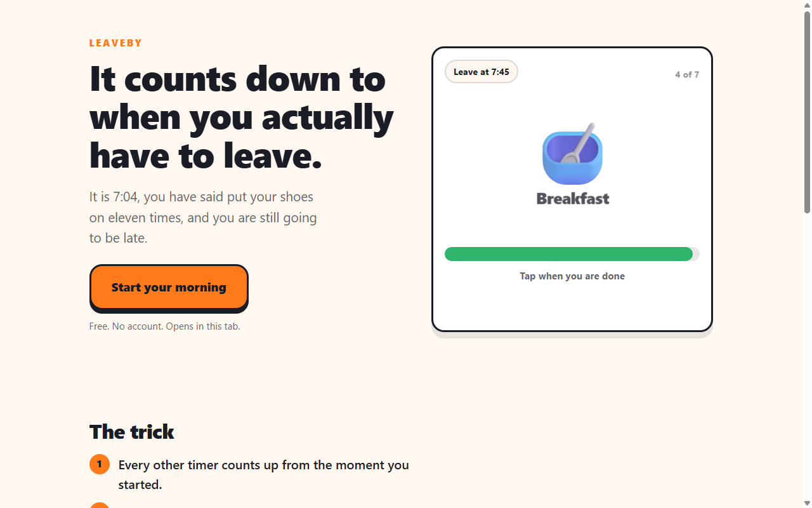
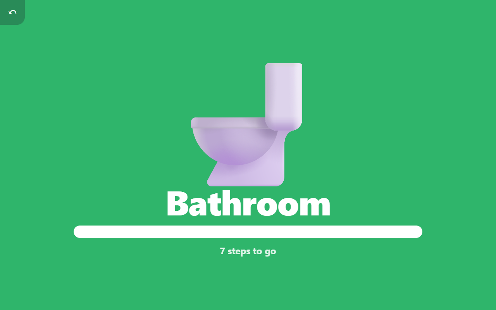

# LeaveBy

The morning routine that counts backwards from the door.

## What it is

LeaveBy is a free web page for parents of young kids to run the morning routine. Set the time you need to leave and the list of steps once, then hand the screen to your kid. Each step fills the whole screen with a giant emoji and a bar that drains toward that step's real deadline, counted backwards from when you need to be out the door. If the morning falls behind, LeaveBy drops optional steps and tells the kid which one got skipped and why. Finish early and the extra minutes get banked, building a streak of on-time mornings.

## Screenshots




## The one-device deal

The routine lives in the browser of the one device you prop on the counter. The share link is a copy, not a sync. Send it to someone else and they get their own routine, not a live connection to yours.

## Try it

https://ucsandman.github.io/leaveby/

## Run locally

Open index.html. There is no build step.

## Tests

Open test.html in a browser, or run:

```
node js/schedule.test.js
```

## How it works

Every step's deadline is set backwards from the leave time, not forwards from when you started. The last step's deadline is the leave time itself. Each earlier deadline is the leave time minus the total minutes of every step still ahead of it. Recomputing from "now" on every tick means a late start just eats into what's left instead of breaking the plan. When the math goes negative, optional steps drop off the end of the list, one at a time, until it works again.

## Deploy your own

Fork the repo, enable GitHub Pages on main, done.
